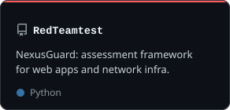
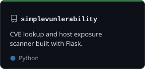
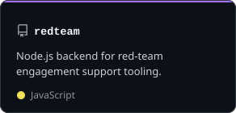

  <picture>
    <source media="(prefers-color-scheme: dark)" srcset="./assets/overview-dark.svg" />
    <source media="(prefers-color-scheme: light)" srcset="./assets/overview-light.svg" />
    
  </picture>

  
  

### About me

I am a cybersecurity consultant focused on offensive security. I run red team and
penetration testing engagements, break into web, API and mobile applications, and
review cloud configurations, then turn the findings into fixes teams can act on.

- 🔭 **Now:** Consultant, Cybersecurity @ Protiviti (IAFA practice), Coimbatore
- 🛡️ **Focus:** red teaming · Active Directory attacks · web, API and Android VAPT · cloud config review
- ☁️ **Cloud:** AWS, Azure and Alibaba Cloud reviews against CIS, NCA ECC and CCC
- 🎯 **Working toward:** CPTS (Hack The Box) and CRTP (Altered Security)

### Featured

  <a href="https://github.com/kishankumar2003/RedTeamtest"><picture><source media="(prefers-color-scheme: dark)" srcset="./assets/repo-redteamtest-dark.svg" /><source media="(prefers-color-scheme: light)" srcset="./assets/repo-redteamtest-light.svg" /></picture></a>
  <a href="https://github.com/kishankumar2003/simplevunlerability"><picture><source media="(prefers-color-scheme: dark)" srcset="./assets/repo-simplevunlerability-dark.svg" /><source media="(prefers-color-scheme: light)" srcset="./assets/repo-simplevunlerability-light.svg" /></picture></a>
  <a href="https://github.com/kishankumar2003/redteam"><picture><source media="(prefers-color-scheme: dark)" srcset="./assets/repo-redteam-dark.svg" /><source media="(prefers-color-scheme: light)" srcset="./assets/repo-redteam-light.svg" /></picture></a>

### Toolbox

  &nbsp;
  &nbsp;
  &nbsp;
  &nbsp;
  &nbsp;
  &nbsp;
  

  
  
  
  
  
  

