<p align="center">
  <picture>
    <source media="(prefers-color-scheme: dark)" srcset="./assets/banner-dark.svg" />
    <source media="(prefers-color-scheme: light)" srcset="./assets/banner-light.svg" />
    
  </picture>
</p>

<p align="center">
  
  
  
</p>

## `whoami`

Offensive security consultant with about two years of hands-on red team and
penetration testing work. I get into web, API and mobile apps, chase paths
through Active Directory, and review cloud setups, then write it up so the
blue side can actually close the gaps.

> I only test systems I am authorized to test.

## What I do

| Area | In practice |
|------|-------------|
| **Red teaming** | Active Directory attack paths, lateral movement, privilege escalation |
| **App security** | Web, API and Android VAPT with Burp, MobSF, Frida and JADX |
| **Cloud review** | AWS, Azure and Alibaba Cloud configs against CIS, NCA ECC and CCC |
| **Threat intel** | Recon and CTI on authorized scope, plus bug bounty on the side |

## Certifications in progress

<p>
  
  
</p>

## Selected projects

- **[RedTeamtest](https://github.com/kishankumar2003/RedTeamtest)** &mdash; NexusGuard, a modular web and network security assessment framework. `Python`
- **[simplevunlerability](https://github.com/kishankumar2003/simplevunlerability)** &mdash; CVE lookup and host exposure scanner built on Flask. `Python`
- **[redteam](https://github.com/kishankumar2003/redteam)** &mdash; Node.js backend for red-team engagement support. `JavaScript`

## Toolkit

```text
Offense    Burp Suite · Metasploit · BloodHound · NetExec · Nmap · OWASP ZAP
Mobile     MobSF · Frida · JADX · Objection
Cloud      Prowler · ScoutSuite · AWS · Azure · Alibaba Cloud
Scripting  Python · Bash · PowerShell
Platform   Kali Linux · Windows · VMware
```

## Find me

<p>
  <a href="https://www.linkedin.com/in/YOUR-LINKEDIN"></a>
  <a href="mailto:dasarikishankumar2003@gmail.com"></a>
</p>
