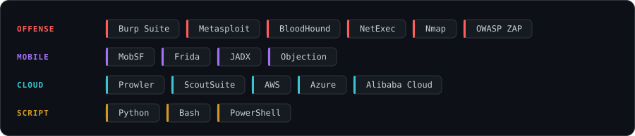

  <picture>
    <source media="(prefers-color-scheme: dark)" srcset="./assets/banner-dark.svg" />
    <source media="(prefers-color-scheme: light)" srcset="./assets/banner-light.svg" />
    
  </picture>

  

  
  
  

## `whoami`

Offensive security consultant with around two years of hands-on red team and
penetration testing work. I get into web, API and mobile apps, chase paths
through Active Directory, and review cloud setups, then write findings up so
the blue side can actually close the gaps.

## What I do

| Area | In practice |
|------|-------------|
| **Red teaming** | Active Directory attack paths, lateral movement, privilege escalation |
| **App security** | Web, API and Android VAPT with Burp, MobSF, Frida and JADX |
| **Cloud review** | AWS, Azure and Alibaba Cloud configs against CIS, NCA ECC and CCC |
| **Threat intel** | Recon and CTI on authorized scope, plus bug bounty on the side |

## Toolkit

  <picture>
    <source media="(prefers-color-scheme: dark)" srcset="./assets/toolkit-dark.svg" />
    <source media="(prefers-color-scheme: light)" srcset="./assets/toolkit-light.svg" />
    
  </picture>

## Selected projects

  <a href="https://github.com/kishankumar2003/RedTeamtest"><picture><source media="(prefers-color-scheme: dark)" srcset="./assets/proj-redteamtest-dark.svg" /><source media="(prefers-color-scheme: light)" srcset="./assets/proj-redteamtest-light.svg" /></picture></a>
  <a href="https://github.com/kishankumar2003/simplevunlerability"><picture><source media="(prefers-color-scheme: dark)" srcset="./assets/proj-simplevuln-dark.svg" /><source media="(prefers-color-scheme: light)" srcset="./assets/proj-simplevuln-light.svg" /></picture></a>
  <a href="https://github.com/kishankumar2003/redteam"><picture><source media="(prefers-color-scheme: dark)" srcset="./assets/proj-redteam-dark.svg" /><source media="(prefers-color-scheme: light)" srcset="./assets/proj-redteam-light.svg" /></picture></a>

## Find me

  
  

